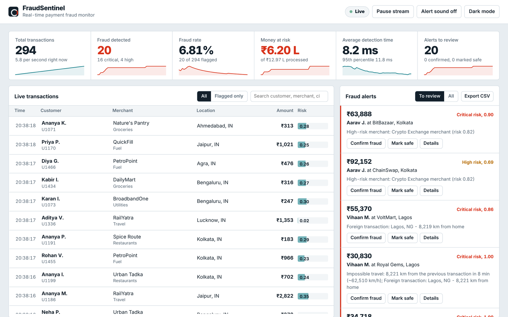
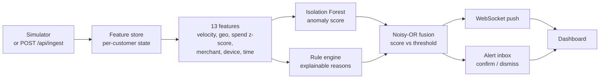
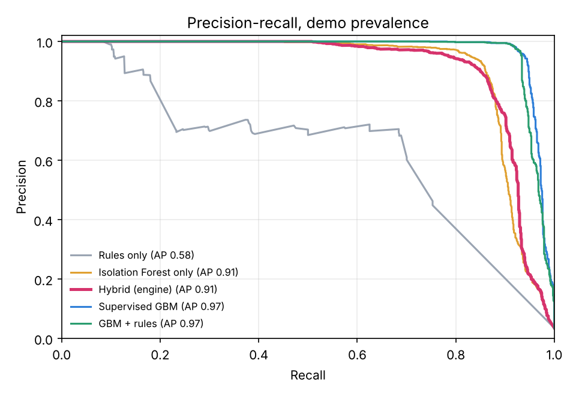

# FraudSentinel: real-time fraud detection engine

[](https://github.com/YOUR-USERNAME/fraud-detection-engine/actions)

A streaming fraud-detection service with a live analyst dashboard. Every payment is scored in a few milliseconds, flagged payments come with plain-language reasons, and analysts confirm or dismiss alerts in the browser.



**Stack:** Python 3.11, FastAPI, WebSockets, scikit-learn, Chart.js, Leaflet, pytest, Docker, GitHub Actions.

## Highlights

- **Hybrid detection:** an unsupervised Isolation Forest plus explainable rules, fused with a noisy-OR. Every alert says *why* it fired.
- **Evaluated against baselines, not just itself:** rules only, Isolation Forest only, the hybrid, and a supervised gradient-boosting model, at two fraud rates and on attacks held out of training. See [docs/RESULTS.md](docs/RESULTS.md).
- **Measured, not guessed:** fusion weights and the alert threshold were tuned on a separate validation stream, and individual rules are weighted by their measured precision.
- **~6 ms per transaction** (p95 ~8 ms), about 1,300 txn/s on one CPU core.
- **Production-minded API:** input validation, optional API-key auth, env-based config, structured logging, health check, OpenAPI docs.
- **Tested:** 29 tests (engine logic, API, auth, WebSocket), linted, CI on Python 3.11 and 3.12, container smoke test.

## Quick start

```bash
pip install -r backend/requirements.txt
cd backend && python app.py        # http://localhost:8000
```

Or `make install run`, or with Docker: `docker build -t fraudsentinel . && docker run -p 8000:8000 fraudsentinel`.

The model trains in about 2 seconds at startup and the simulated stream begins. Chart.js and Leaflet are bundled, so the dashboard works offline (map tiles and the web font need internet).

## Architecture



For each transaction the engine builds features from the customer's own history (payments in the last 1 and 10 minutes, distance and implied speed since the last payment, distance from home, log z-score of the amount against that customer's running mean and variance, merchant risk, new device, time of day). Then:

1. An **Isolation Forest** trained on simulated normal behaviour gives an anomaly score in [0, 1].
2. **Rules** (velocity, impossible travel, amount spike, card testing, risky merchant, new device, foreign payment, odd hours) give a rule score and human-readable reasons.
3. Fusion: `score = 1 - (1 - 1.0 * ml) * (1 - 0.5 * rules)`. A payment is flagged when `score >= 0.65` (adjustable live).

Payments are scored in 250 ms micro-batches. Detection time is measured from generation to decision.

## Results

Reproduce with `cd backend && python evaluate.py` (about 90 s, fixed seeds). Test streams use a different seed and different simulated customers from training.

| Method (30k txns, 3.5% fraud) | ROC-AUC | PR-AUC | Recall @ 1% false-positive rate |
|---|---:|---:|---:|
| Rules only | 0.868 | 0.577 | 0.62 |
| Isolation Forest only | 0.978 | 0.908 | 0.88 |
| **Hybrid (this engine)** | **0.980** | **0.911** | **0.89** |
| Supervised gradient boosting | 0.997 | 0.972 | 0.96 |

At the default threshold of 0.65: **precision 0.89, recall 0.86, F1 0.87**. At a more realistic 0.46% fraud rate the hybrid keeps PR-AUC 0.83.



What the comparison shows:

- **The hybrid beats both of its parts.** An earlier version, with hand-picked fusion weights and equal trust in every rule, was *worse* than the Isolation Forest alone (PR-AUC 0.85 vs 0.91; F1 0.76). Measuring per-rule precision showed three noisy rules (`RISKY_MERCHANT` 28%, `ODD_HOURS` 25%, `GEO_JUMP` 4%) diluting the score. Down-weighting them and retuning the fusion on a validation stream fixed it.
- **A supervised model wins when it has seen the attack, and fails when it hasn't.** Trained without card-testing examples, it catches 17% of card-testing fraud; the hybrid catches 98% because it does not depend on labels. Full table in [docs/RESULTS.md](docs/RESULTS.md).
- **Known weakness:** isolated single-payment amount spikes are caught only 18% of the time at the default threshold. The Isolation Forest does not see them in 13 dimensions and the spike rule is only about 43% precise. A per-customer spend model or a supervised stage would be the fix.

> The data is synthetic and the rules were written against the same attack patterns the simulator injects, so absolute numbers are optimistic. They demonstrate the pipeline and the trade-offs, not real-world accuracy. Real fraud is rarer and messier; a production system needs labelled data, per-segment thresholds, and drift monitoring.

## Dashboard

Metrics strip with sparklines; live transaction tape with filters; alert inbox with **Confirm fraud** / **Mark safe** and CSV export; timeline, reason, merchant-type and score-distribution charts; live map; precision/recall/F1 and latency; control centre (stream speed, threshold, fraud share, simulated attacks); a **Risk checker** for what-if scoring; a per-transaction score breakdown with the most unusual signals; dark and light themes.

## API

Interactive docs at `http://localhost:8000/docs`.

| Method | Path | Auth | Purpose |
|---|---|---|---|
| POST | `/api/ingest` | key | Score a real transaction, update customer state, push to the dashboard |
| POST | `/api/score` | | Dry-run risk check; nothing is stored |
| GET | `/api/stats`, `/api/transactions`, `/api/alerts` | | Metrics, recent transactions, alerts |
| POST | `/api/alerts/{id}/resolve` | key | `{"status": "confirmed" \| "dismissed" \| "open"}` |
| GET / POST | `/api/config` | POST: key | Threshold, stream speed, fraud share, pause |
| POST | `/api/simulate/attack?kind=geo` | key | `velocity`, `geo`, `spike`, `takeover`, `card_testing`, `random` |
| POST | `/api/reset` | key | Reset counters |
| GET | `/api/export/alerts.csv`, `/api/meta`, `/api/health` | | Export, metadata, health |
| WebSocket | `/ws` | | Live push: `snapshot`, `tick`, `alert_update`, `config`, `reset` |

```bash
curl -X POST localhost:8000/api/ingest -H "Content-Type: application/json" -H "X-API-Key: $KEY" \
  -d '{"user_id":"U1001","amount":84000,"category":"Electronics","merchant":"VoltMart",
       "city":"London","country":"GB","device_id":"new-phone"}'
```

### Configuration (environment variables)

| Variable | Effect |
|---|---|
| `FRAUD_API_KEY` | If set, state-changing endpoints require `X-API-Key`. The dashboard asks for the key once. Unset means open demo mode (a warning is logged). |
| `FRAUD_THRESHOLD` | Initial alert threshold (default 0.65) |
| `FRAUD_STREAM_RATE` | Simulated transactions per second (default 6) |
| `FRAUD_SIMULATE=0` | Disable the simulator and score only ingested traffic |
| `FRAUD_CORS_ORIGINS` | Comma-separated allowed origins (default `*`, demo only) |
| `FRAUD_LOG_LEVEL` | Logging level (default `INFO`) |

## Development

```bash
make install   # runtime + dev dependencies
make test      # pytest (29 tests)
make lint      # ruff
make eval      # regenerate docs/RESULTS.md and the PR curve
```

```
backend/
  app.py         FastAPI app: REST, WebSocket, auth, streaming loop
  engine.py      features, Isolation Forest, rules, fusion, stats, alert workflow
  simulator.py   synthetic transaction stream with 5 fraud scenarios
  evaluate.py    baselines, ablation, low-prevalence and held-out-attack evaluation
  tests/         engine and API tests
frontend/        dashboard (HTML, CSS, JS; Chart.js and Leaflet bundled)
docs/            RESULTS.md, charts, screenshot
.github/workflows/ci.yml
```

## Limitations and next steps

- State is in memory in one process. Production: Kafka/Kinesis input, Redis or a feature store for customer state, PostgreSQL for alerts and an audit log, several workers.
- Read endpoints are unauthenticated and alert history is capped in memory. Add real authentication and roles before exposing it.
- Validate on a public labelled dataset (for example the ULB credit-card fraud or IEEE-CIS data) to get numbers that do not come from the author's own simulator.
- Add a supervised stage and retrain on analyst-confirmed alerts; monitor drift and false-positive rate; tune thresholds per merchant segment.
- `/api/ingest` defaults a missing timestamp to the simulator's virtual clock so it lines up with simulated customers; pass `timestamp` for real traffic.

## Suggested 3-minute demo

1. Show the live tape and metrics strip; point out detection time in milliseconds.
2. Press **Impossible travel**: a red row appears with its reason and a toast fires. Open it, show the score breakdown, press **Confirm fraud**.
3. Press **Rapid-fire payments** and watch velocity alerts stack up.
4. Drag the **alert threshold** and show precision and recall trade off.
5. Use the **Risk checker**, then show the `curl` call to `/api/ingest`.
6. Close on [docs/RESULTS.md](docs/RESULTS.md): the baselines, and the attack the supervised model misses that the hybrid catches.
